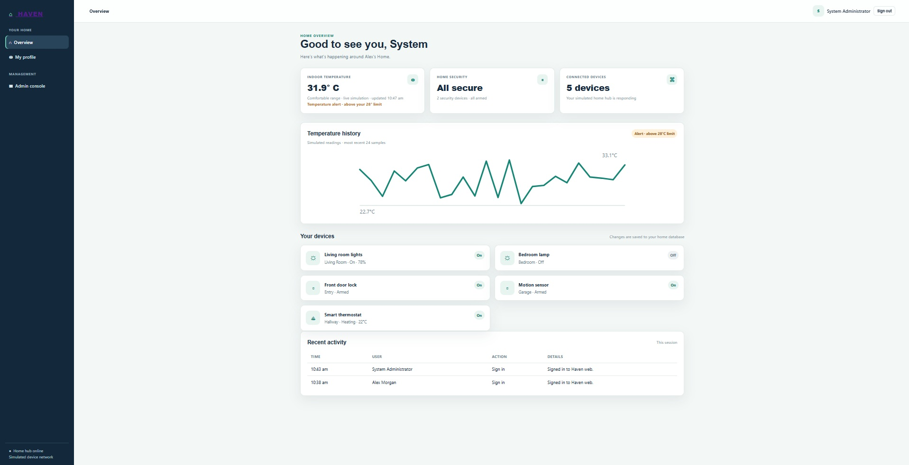
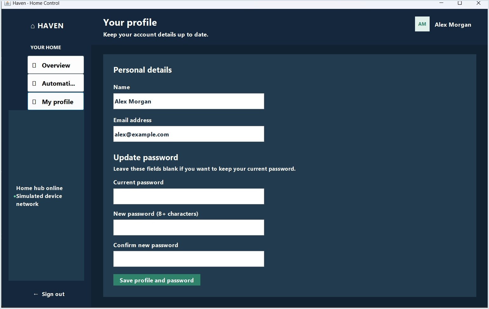

# Haven — Online Home Automation Platform

Haven is a Java project for controlling a simulated smart home. It has two ways to use it: a Swing desktop app and a browser app built with Java Servlets. I built it to practise Java, JDBC, and role-based interfaces while making a project that is easy to demonstrate.

The devices and sensor readings are simulated. Nothing here connects to real locks, lights, or thermostats.

## What you can do

As a **Homeowner**, you can:
- Check temperature, security status, and connected devices.
- Turn devices on or off, and adjust supported lights and thermostats.
- Create, enable, pause, and manually run automation routines.
- Review recent activity and a chart of simulated temperature readings.
- Update your profile and password.

As an **Admin**, you can:
- Create and manage user accounts and roles.
- Review device compatibility requests.
- Update system settings and review system activity.

Both versions share the Java domain and repository code. The desktop demo can run in memory; the persistent desktop and web versions use SQLite through JDBC. Passwords are stored as salted PBKDF2 hashes.

A couple of demo limits: activity history holds up to 100 events and temperature history up to 24 readings for the current run. These histories reset when the app restarts. Routine conditions are descriptions for this demo; they are not automatically evaluated. **Run now** manually performs the routine's supported on/off action.

## Requirements

- JDK 21 or newer.
- Maven 3.9 or newer for the web app and SQLite/JAR builds.
- Internet access the first time Maven downloads dependencies.

## Try the desktop app

Open PowerShell in the project folder, then run:

```powershell
Set-ExecutionPolicy -Scope Process -ExecutionPolicy Bypass
.\run-demo.ps1
```

This starts the in-memory demo, so changes made in that run are cleared when you close it. The policy setting only applies to the current PowerShell window.

### Demo sign-ins

| Role | Email | Password |
| --- | --- | --- |
| Homeowner | `alex@example.com` | `Home123!` |
| Admin | `admin@haven.local` | `Admin123!` |

You can also register a homeowner account from the sign-in screen. Public registration does not allow creating an Admin account.

### A quick desktop walkthrough

1. Sign in as the homeowner and try a device control.
2. Open **Automations**, then use **Run now** on an enabled routine.
3. Visit **History** to see the action and the simulated temperature chart.
4. Sign out and sign in as Admin. Open the Admin console to review users and settings.

## Try the browser app

The web app lives in `web/`. It uses Servlets for sign-in, session handling, role checks, homeowner controls, and Admin pages. A security filter protects role-specific routes and checks submitted forms. Jetty runs the app locally during development.

From the project folder, run:

```powershell
cd web
.\run-web.ps1
```

Keep that PowerShell window open, then visit [http://localhost:8080](http://localhost:8080) in your browser. Sign in with either demo account above. Press **Ctrl+C** in the PowerShell window to stop the server.

The web app saves data to `home-automation-web.db` in its working directory by default. To set the SQLite URL yourself before startup:

```powershell
$env:HOME_AUTOMATION_DB = 'jdbc:sqlite:home-automation-web.db'
.\run-web.ps1
```

To build the deployable WAR instead of starting Jetty:

```powershell
mvn package
```

The WAR is created at `web/target/haven-web.war` and requires a Servlet 6 compatible server, such as Tomcat 10.1 or later.

### What the web screenshots show

These are screenshots captured from the running browser version. Together they show the Admin dashboard and two working Admin tasks:

- **Overview:** account and device totals, home status, temperature, and navigation to the management pages.
- **Users:** existing accounts and roles, plus the form for adding an account and the available account actions.
- **Settings:** editable home-wide settings, including the display name and temperature alert limit.

The screenshots document the pages and visible results of the web application. The user and settings pages demonstrate that Admin data can be viewed and changed through the browser interface; the screenshots are visual evidence, while the feature checks below exercise selected behavior in code.




## Data and project checks

For a persistent desktop build, open PowerShell in the project folder and run:

```powershell
mvn clean package
$env:HOME_AUTOMATION_DB = 'jdbc:sqlite:home-automation.db'
java -jar target/home-control-platform-1.0.0.jar
```

The first launch creates the database tables and sample records. The desktop in-memory demo does not use this database setting.

To run the included feature checks, first build the web project once so Maven downloads the Servlet API. Then, from the project folder:

```powershell
Set-ExecutionPolicy -Scope Process -ExecutionPolicy Bypass
.\run-checks.ps1
```

The checks cover core automation and validation behavior, activity and temperature history, HTML escaping, and denying a homeowner access to Admin routes.

## Screenshots of the desktop app

The following screenshots show the Swing application. They are included alongside the three browser captures above so reviewers can see both interfaces.

### Sign-in


### Homeowner screens




### Admin screens


## How the project is organized

```text
src/main/java/edu/homeautomation/
  model/          Users, devices, routines, and environment readings
  persistence/    Repository interface and in-memory/JDBC implementations
  service/        Device control, environment monitoring, password hashing
  ui/             Swing sign-in and role dashboards
src/main/resources/schema.sql
src/test/java/    Core feature checks
web/
  pom.xml
  src/main/java/  Servlets, access control, and shared web helpers
  src/main/webapp/ Pages, styles, and Servlet configuration
  src/test/java/  Web feature checks
screenshots/readme/  Screenshots embedded in this README
run-demo.ps1
run-checks.ps1
```

## Java concepts shown

- **OOP:** device inheritance, polymorphic behavior, interfaces, and exception handling.
- **Collections and generics:** typed lists and repository collections.
- **Threads and synchronization:** a background environment monitor and synchronized shared state.
- **Database design:** repository classes separate storage operations from the interface.
- **JDBC:** SQLite persistence for users, devices, routines, and settings.
- **Servlets:** role-aware browser routes, sessions, form handling, and web integration.

