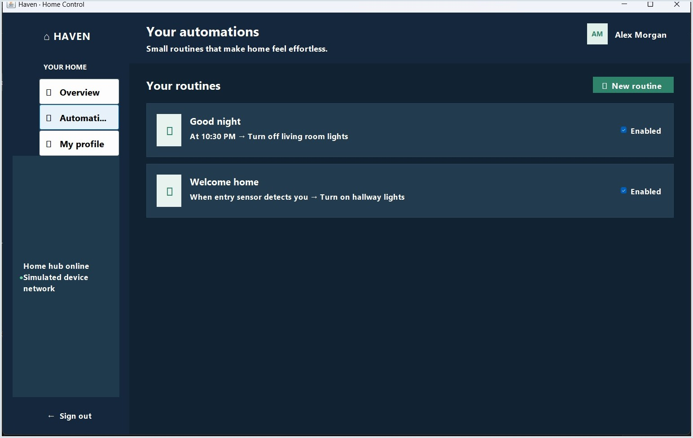

# Online Home Automation Control Platform

Haven includes a Java Swing desktop app and a browser-based Java Servlet app for managing a simulated smart home. Homeowners can control devices, create automation routines, and monitor home conditions. Administrators can manage users, device compatibility, and system settings. Both versions use the same Java domain classes and support SQLite persistence.

> Device commands and environment readings are simulated. This classroom project does not connect to physical home devices.

## Features

- Login for Homeowner and Administrator roles, plus homeowner account creation.
- Profile-based password changes require the current password and confirmation of the new password.
- Passwords are stored as salted PBKDF2 hashes in the app's repositories.
- Homeowner overview for device status, room filtering, security state, and temperature alerts.
- Simulated on/off controls and brightness/thermostat adjustment.
- Automation routines with editable enable/disable status.
- A **Run now** control for enabled on/off routines. Actions use the exact format `Turn on [device name]` or `Turn off [device name]`.
- A **History** page with recent device and admin actions, a temperature chart, and clear alert/within-range status.
- Profile editing for account name and email.
- Administrator user creation, editing, role assignment, and removal, with safeguards for the active and final administrator.
- Device compatibility approval and system settings.
- A background environment monitor, generic repository interface, synchronized operations, and JDBC SQLite persistence.
- A separate, responsive Servlet web application with role-based pages and session sign-in.

The activity list is an in-memory history of up to 100 recent events, and the temperature chart keeps up to 24 simulated readings for the current run. Both reset when the app restarts.
Routine conditions are descriptive in this classroom demo; they are not evaluated against a clock or physical sensor. **Run now** manually runs the supported on/off action.

## Requirements

- JDK 21 or later.
- For a quick in-memory demo: the JDK only.
- For SQLite persistence and the packaged JAR: Maven 3.9 or later and internet access for the first dependency download.

## Run the in-memory demo

Open PowerShell in this project folder and run:

```powershell
Set-ExecutionPolicy -Scope Process -ExecutionPolicy Bypass
.\run-demo.ps1
```

The policy change applies only to that PowerShell window. The app compiles from source and launches with demo data. Demo-mode changes are cleared when the app closes.

If PowerShell blocks the script, run `Set-ExecutionPolicy -Scope Process -ExecutionPolicy Bypass` in that window before launching it.

### First-time walkthrough

1. Sign in with one of the demo accounts below, or choose **Create a homeowner account** to register.
2. A homeowner can use **Overview** to check temperature, security, and connected devices. Use the device controls to switch a device on or off; **Adjust** is available for supported lights and thermostats.
3. Open **Automations** to create a routine and choose its condition and action. To run it immediately, use an action such as `Turn off Bedroom lamp`, then select **Run now**.
4. Open **History** to review device commands and account changes. The temperature chart fills as simulated readings arrive every five seconds.
5. Open **My profile** to edit account details or change the password. Password changes ask for the current password and confirmation of the new one.
6. Sign in as the administrator to open **Admin console**. Review the **Users** and **System** tabs, then open **History** to see recorded admin actions.

### Short presentation walkthrough

1. Start the desktop demo and sign in as the homeowner.
2. Switch a device, then open **History** to show the recorded action.
3. Open **Automations** and select **Run now** on **Good night**. The sample action turns off Living room lights.
4. Sign out and sign in as the administrator. Open **Admin console → Users** and **Admin console → System** to show account management and temperature settings.
5. Save a home display name or temperature-limit change, then open **History** to show the admin action.
6. Explain that devices and readings are simulated and that the Java Servlet version provides the browser interface.

The application displays confirmation or validation messages when an action succeeds or needs attention. Device behavior and environment values are simulated.

### Demo accounts

| Role | Email | Password |
|---|---|---|
| Homeowner | `alex@example.com` | `Home123!` |
| Administrator | `admin@haven.local` | `Admin123!` |

Use **Create a homeowner account** to register another homeowner. Public registration cannot create administrator accounts.

## Run with persistent SQLite storage

From the project folder, build the runnable JAR:

```powershell
mvn clean package
```

Then set the database URL and launch the JAR:

```powershell
$env:HOME_AUTOMATION_DB = 'jdbc:sqlite:home-automation.db'
java -jar target/home-control-platform-1.0.0.jar
```

The app creates the database tables and sample records on first launch. Users, devices, automation routines, and system settings are saved in the SQLite database. Environment readings are simulated for the current app session.

To return to in-memory demo mode, close the app and open a new PowerShell window without setting `HOME_AUTOMATION_DB`.

## Run the web version

The Servlet-based web app is in the `web/` folder. It reuses the Java models, password hashing, and JDBC repository from the desktop project.

Requirements: JDK 21 or later, Maven 3.9 or later, and internet access for the first dependency download.

In PowerShell, from the project folder, run:

```powershell
cd web
.\run-web.ps1
```

Or start it directly with Maven:

```powershell
cd web
mvn jetty:run
```

When startup completes, open [http://localhost:8080](http://localhost:8080). Sign in with the demo accounts above, or create a homeowner account. The web version uses a persistent SQLite database named `home-automation-web.db` in the current working directory by default. To select another JDBC URL before starting, set `HOME_AUTOMATION_DB` in PowerShell:

```powershell
$env:HOME_AUTOMATION_DB = 'jdbc:sqlite:home-automation-web.db'
```

To build a WAR for a Servlet 6 compatible server such as Tomcat 10.1 or later:

```powershell
mvn package
```

The generated file is `web/target/haven-web.war`.

## Run the project checks

The dependency-light checks cover on-demand automation, invalid automation input, activity-history limits, temperature status, HTML escaping, and homeowner denial from admin routes. From the project folder, run:

```powershell
Set-ExecutionPolicy -Scope Process -ExecutionPolicy Bypass
.\run-checks.ps1
```

The script compiles the Java sources and runs both check classes. It uses the Jakarta Servlet API downloaded when the web project is built with Maven.

## Rubric mapping

- **OOP:** `SmartDevice` inheritance, concrete device types, `Switchable`, polymorphic status, and validation/SQL exceptions.
- **Collections and generics:** typed lists and repository collections; thread-safe listener collection.
- **Multithreading and synchronization:** background environment monitor and synchronized device/repository state.
- **Database operations and JDBC:** `HomeRepository`, `InMemoryHomeRepository`, and `JdbcHomeRepository`.

The project includes both a Java Swing desktop application and a separate Servlet-based web application. The web version demonstrates server-side Java, role-based servlet routes, session handling, and JDBC-backed data.

### Updated rubric mapping

- **Servlet implementation:** the browser version uses Java Servlets for sign-in, homeowner actions, administrator functions, and role-protected routes. Servlet code is in `web/src/main/java/edu/homeautomation/web/`; it is a companion web app, separate from the Swing desktop interface.
- **Code quality and execution:** shared models and services, repository classes, input checks, user-facing error messages, and setup scripts support a modular build and run flow.
- **Code quality and testing:** `run-checks.ps1` compiles the GUI and Servlet sources and runs checks for device automation, validation, temperature status, HTML escaping, and role access.
- **Teamwork and collaboration:** use `TEAM-CONTRIBUTIONS.md` to record real feature ownership, reviews, and commit evidence. Replace its example rows before submitting.
- **Innovation / extra effort:** the History page, simulated temperature chart, and on-demand automation make application behavior easier to demonstrate.

## Screenshots

The screenshots below show the application with its demo data. The copies in `screenshots/readme/` have a narrow border, and a small strip above the app window has been cropped from screenshots where it appeared. The original captures remain in `screenshots/`.

### Sign-in


### Homeowner dashboard and features

**Overview and device controls**


**Automation routines**



**Profile and password update**


### Administrator dashboard and features

**System overview**


**Device compatibility review**


**Administrator profile**


**Web version: user management**


**Web version: system settings**


## Project structure

```text
src/main/java/edu/homeautomation/
  Main.java
  model/                  Devices, users, routines, and environment readings
  persistence/            Repository interface and demo/JDBC implementations
  service/                Device control, environment monitor, password hashing
  ui/                     Sign-in, registration, and role dashboards
src/main/resources/schema.sql
web/
  pom.xml                  Servlet web-app build and Jetty run configuration
  src/main/java/           Web servlets, access control, and shared HTML helpers
  src/main/webapp/         Responsive pages, CSS, and Servlet configuration
src/test/java/              Shared Java feature checks
web/src/test/java/           Servlet access-control and HTML-safety checks
run-checks.ps1               Compile and run project checks
TEAM-CONTRIBUTIONS.md        Record actual team roles and contribution evidence
```

## Classroom demo note

The seeded accounts are for demonstration only. Replace them with a proper account provisioning and recovery flow before using the software outside a classroom setting.
