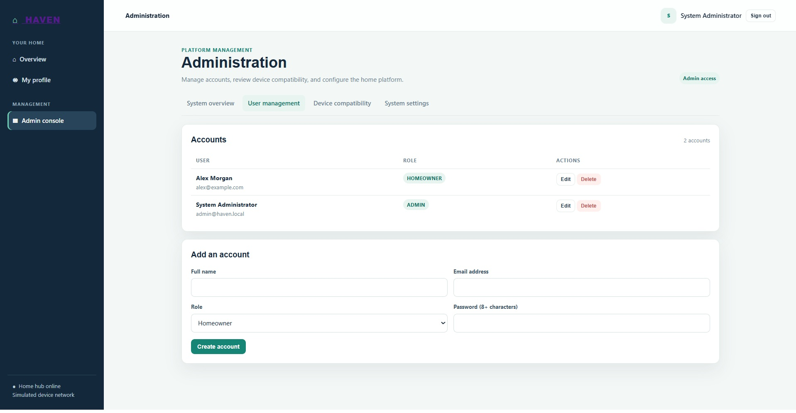
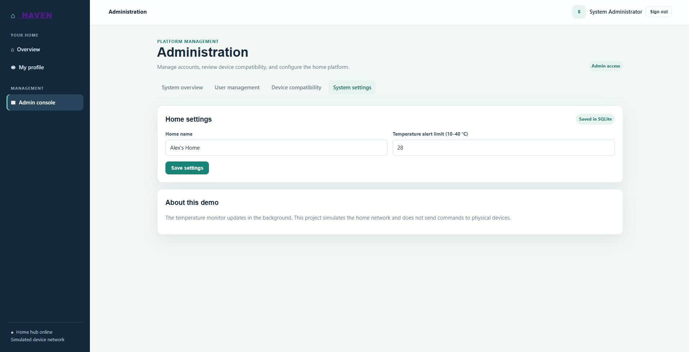
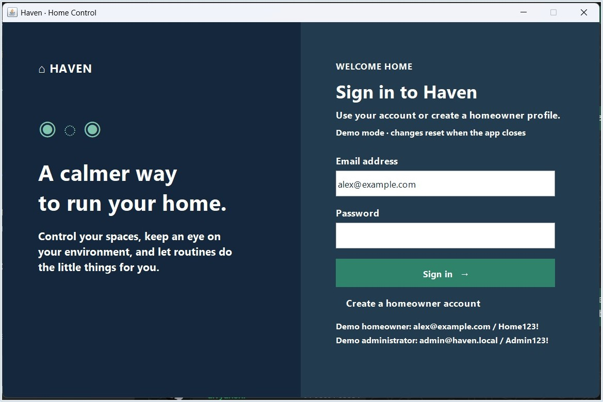
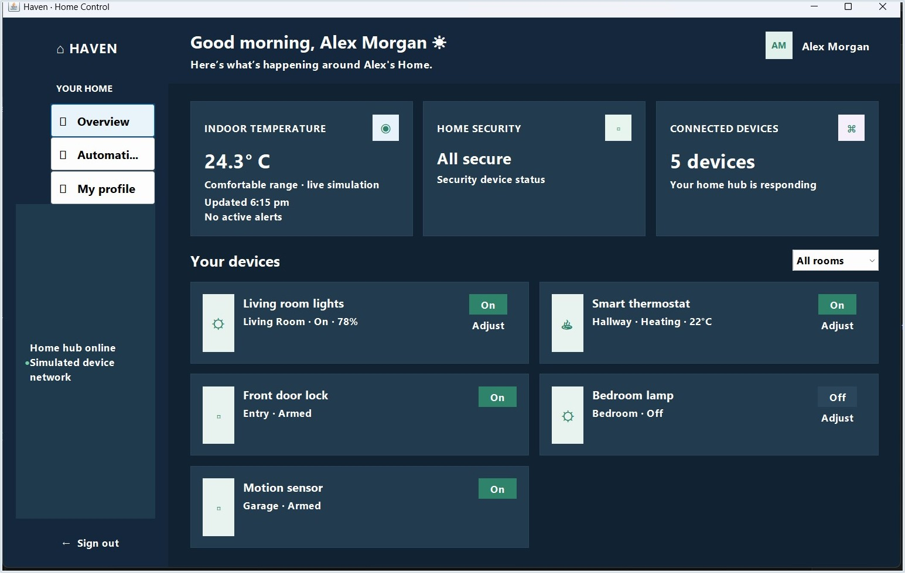
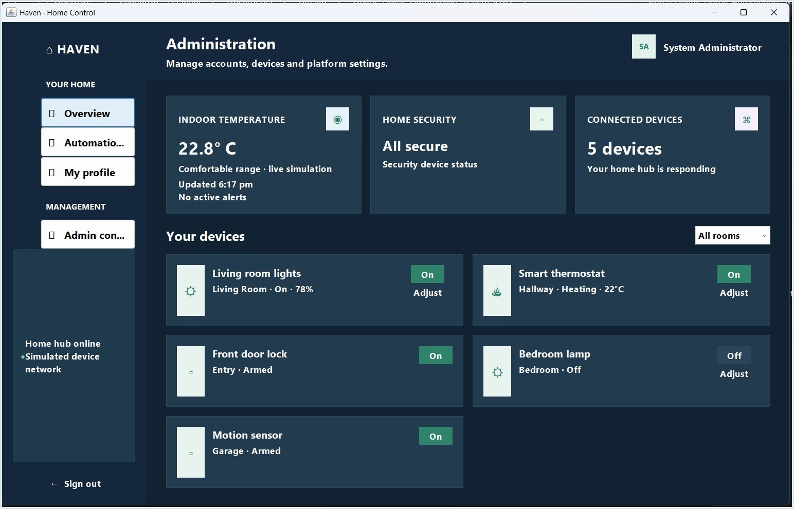
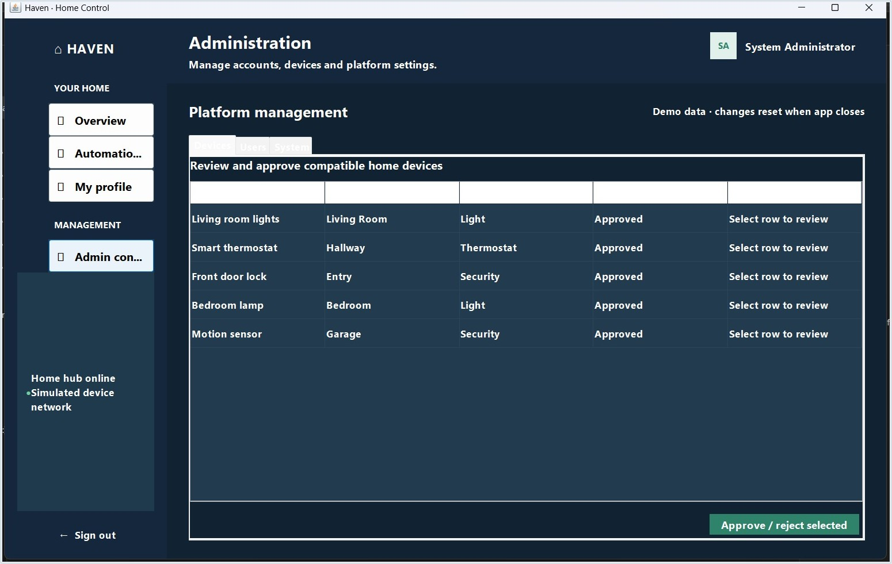
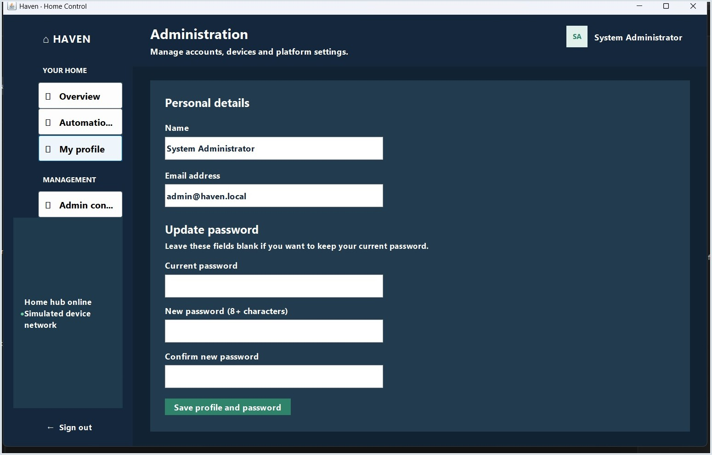

# Haven: Online Home Automation Platform

<<<<<<< HEAD
Haven is a Java home automation project with a Swing desktop app and a separate browser-based app. Both use demo devices and simulated sensor readings, so the project is safe to try without any smart-home hardware.

## The two versions
=======
**Haven** is a Java Swing application for managing a simulated smart home. Homeowners can control devices, create automation routines, and check home conditions. Administrators can review devices, manage accounts, and configure system settings.

The app simulates device commands and environment readings. It does not connect to physical home devices.
>>>>>>> 064d7976ad480e70779bce6b8fa5d6731ce7ce1d

### Browser app (Java Servlets)

<<<<<<< HEAD
The web version runs locally in a browser. Java Servlets handle sign-in, form submissions, device actions, and Admin pages. A login session keeps track of the signed-in user, and role checks restrict Admin pages to Admin accounts. The app uses SQLite through JDBC to save its data.
=======
- Homeowner and administrator sign-in
- Homeowner account creation
- Profile editing and password updates
- Device status, room filters, security status, and temperature readings
- Simulated device controls, including on/off, light brightness, and thermostat adjustments
- Automation routines with conditions, actions, and enable/disable controls
- Administrator tools for account and role management, device compatibility, and system settings
- Background environment monitoring
- SQLite database support through JDBC

Passwords are stored as salted PBKDF2 hashes.
>>>>>>> 064d7976ad480e70779bce6b8fa5d6731ce7ce1d

Homeowners can view the home dashboard, operate simulated devices, manage automation routines, check environment readings and recent activity, and edit their profile. Admins can view system status, manage accounts, approve or reject devices, and change home settings.

<<<<<<< HEAD
To start it, open PowerShell in the project folder and run:

```powershell
cd web
.\run-web.ps1
```

When the server starts, open [http://localhost:8080](http://localhost:8080). Keep PowerShell open while using the site; press **Ctrl+C** there to stop it. The first Maven run may take a little longer while it downloads dependencies.

The web app saves its SQLite database as `home-automation-web.db` in its working directory. To set the database URL explicitly before starting:

```powershell
$env:HOME_AUTOMATION_DB = 'jdbc:sqlite:home-automation-web.db'
.\run-web.ps1
```

To build a WAR file instead of running the local server:

```powershell
mvn package
```

The file is created at `web/target/haven-web.war`. It can be deployed to a Servlet 6 compatible server, such as Tomcat 10.1 or later.

### Web app screenshots

These screenshots were taken from the running web app. They show the homeowner's browser dashboard and the main Admin screens.

**Overview dashboard:** current temperature and security status, connected devices, simulated temperature history, device states, and recent activity. This capture was taken while signed in as System Administrator.


**User management:** the Admin can see account names and roles, edit or delete accounts, and add a new account from this page.



**System settings:** the Admin can change the home name and temperature alert limit. The page also indicates when settings are saved in SQLite.



The screenshots show the pages and saved settings available in the running app. Device controls and sensor readings remain simulated; they do not operate real equipment.

## Desktop app (Java Swing)

The desktop version has the same two roles. Homeowners can control devices, create and run automation routines, view temperature and security information, check activity, and update their profile. Admins can manage users, device compatibility, and system settings.

To run a quick demo, open PowerShell in the project folder and enter:
=======
- JDK 21 or later
- For SQLite storage and the packaged JAR: Maven 3.9 or later
- Internet access the first time Maven downloads the project dependencies

## Run the demo

Open PowerShell in the project folder and run:
>>>>>>> 064d7976ad480e70779bce6b8fa5d6731ce7ce1d

```powershell
Set-ExecutionPolicy -Scope Process -ExecutionPolicy Bypass
.\run-demo.ps1
```

<<<<<<< HEAD
This starts with in-memory demo data. Changes from that session are cleared when the app closes. The execution policy setting only applies to the current PowerShell window.
=======
The script compiles and starts the app with sample data. Changes made in demo mode are cleared when the app closes. The execution-policy change applies only to the current PowerShell window.
>>>>>>> 064d7976ad480e70779bce6b8fa5d6731ce7ce1d

### Demo accounts

| Role | Email | Password |
| --- | --- | --- |
| Homeowner | `alex@example.com` | `Home123!` |
| Admin | `admin@haven.local` | `Admin123!` |

<<<<<<< HEAD
You can create additional Homeowner accounts from the sign-in screen. Public registration cannot create Admin accounts.

## First-time walkthrough
=======
You can also create a homeowner account from the sign-in screen. New accounts cannot be assigned the administrator role through public registration.

## Using the application

1. Sign in with a demo account or create a homeowner account.
2. On the homeowner **Overview** page, check the temperature, security status, and connected devices. Use the device controls to switch supported devices on or off, or adjust lights and thermostats.
3. Open **Automations** to create routines by choosing conditions and actions. You can enable or disable each routine.
4. Open **My profile** to edit your account details or update your password.
5. Sign in as the administrator and open **Admin console** to manage accounts, review device compatibility, update system settings, and monitor the platform.

The app displays messages when an action succeeds or needs attention.

## Run with SQLite storage
>>>>>>> 064d7976ad480e70779bce6b8fa5d6731ce7ce1d

1. Start either version and sign in with one of the demo accounts.
2. As Homeowner, turn a device on or off and look at the dashboard status.
3. Open **Automations** and try **Run now** on an enabled routine.
4. Check recent activity and the temperature history.
5. Sign in as Admin to manage accounts or change system settings.

Automation conditions are shown as part of each routine, but this demo does not evaluate them automatically. **Run now** manually carries out the routine's supported on/off action. The activity list keeps up to 100 events and the temperature chart up to 24 readings during a run; both clear when the app restarts.

## Requirements

- JDK 21 or newer.
- Maven 3.9 or newer for the web app and persistent database builds.
- Internet access the first time Maven needs to download project dependencies.

## Database and checks

For a persistent desktop build, run these commands from the project folder:

```powershell
mvn clean package
<<<<<<< HEAD
=======
```

Set the database location and run the JAR:

```powershell
>>>>>>> 064d7976ad480e70779bce6b8fa5d6731ce7ce1d
$env:HOME_AUTOMATION_DB = 'jdbc:sqlite:home-automation.db'
java -jar target/home-control-platform-1.0.0.jar
```

<<<<<<< HEAD
The first launch creates the database and sample records. The quick `run-demo.ps1` launch does not use this database setting.

To run the included checks, build the web project once first so the Jakarta Servlet API is available, then run from the project folder:

```powershell
Set-ExecutionPolicy -Scope Process -ExecutionPolicy Bypass
.\run-checks.ps1
```

The checks cover core automation and validation, activity and temperature history, HTML escaping, and access control for Admin pages.

## Desktop screenshots
=======
On its first launch, the app creates the database tables and sample records. User accounts, devices, automation routines, and system settings are saved in SQLite. Environment readings remain simulated for the current session.

To return to demo mode, close the app and open a new PowerShell window without setting `HOME_AUTOMATION_DB`.

## Java concepts demonstrated

- **Object-oriented programming:** `SmartDevice` inheritance, concrete device classes, the `Switchable` interface, polymorphism, and exception handling
- **Collections and generics:** typed lists, repository collections, and a thread-safe listener collection
- **Multithreading and synchronization:** a background environment monitor and synchronized device and repository operations
- **Database operations and JDBC:** `HomeRepository`, `InMemoryHomeRepository`, and `JdbcHomeRepository`

This project is a desktop application. It does not use Servlets or provide a web interface.
>>>>>>> 064d7976ad480e70779bce6b8fa5d6731ce7ce1d

These images show the Swing app. The three browser screenshots are shown above.

<<<<<<< HEAD
**Sign-in**
=======
The screenshots show the app using its sample data. The README copies are in `screenshots/readme/`; some have been cropped to remove a strip above the app window and given a narrow border. The original screenshots are also in `screenshots/`.
>>>>>>> 064d7976ad480e70779bce6b8fa5d6731ce7ce1d



**Homeowner overview and devices**

<<<<<<< HEAD

=======
### Homeowner dashboard

**Overview and device controls**


>>>>>>> 064d7976ad480e70779bce6b8fa5d6731ce7ce1d

**Automation routines**


**Homeowner profile**


<<<<<<< HEAD
**Admin overview**
=======
### Administrator dashboard
>>>>>>> 064d7976ad480e70779bce6b8fa5d6731ce7ce1d



**Device compatibility**



**Admin profile**



<<<<<<< HEAD
## Project layout

```text
src/main/java/edu/homeautomation/
  model/          Users, devices, automation routines, and readings
  persistence/    In-memory and JDBC repository implementations
  service/        Device control, environment monitoring, password security
  ui/             Swing screens
=======


The screenshots do not include the administrator user-management or system-settings panels.

## Project structure

```text
src/main/java/edu/homeautomation/
  Main.java
  model/                  Devices, users, routines, and environment readings
  persistence/            Repository interface and demo/JDBC implementations
  service/                 Device control, environment monitor, password hashing
  ui/                      Sign-in, registration, and role dashboards
>>>>>>> 064d7976ad480e70779bce6b8fa5d6731ce7ce1d
src/main/resources/schema.sql
src/test/java/    Core feature checks
web/
  src/main/java/  Servlets and web access control
  src/main/webapp/ Browser pages, styles, and Servlet configuration
  src/test/java/  Web feature checks
screenshots/readme/  Images used in this README
run-demo.ps1
run-checks.ps1
```
<<<<<<< HEAD

## Java topics in the project

The code uses inheritance, polymorphism, interfaces, exception handling, collections and generics, background monitoring, synchronized shared state, repository classes, JDBC with SQLite, and Java Servlets.


=======
>>>>>>> 064d7976ad480e70779bce6b8fa5d6731ce7ce1d
